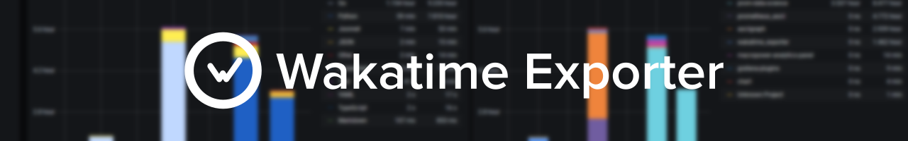
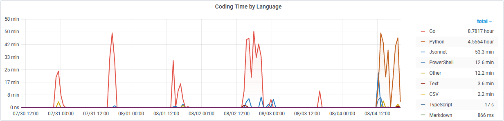

<a href="#"></a>

<h2></h2>
<p align="center">
  <a href="#" target="blank">
    
  </a>
  <a href="https://hub.docker.com/r/macropower/wakatime-exporter" target="blank">
    
  </a>
  <a href="https://hub.docker.com/r/macropower/wakatime-exporter" target="blank">
    
  </a>
  <a href="https://goreportcard.com/report/github.com/MacroPower/wakatime_exporter" target="blank">
    
  </a>
  <a href="https://codeclimate.com/github/MacroPower/wakatime_exporter/maintainability" target="blank">
    
  </a>
</p>

_wakatime_exporter_ is a Prometheus exporter for [Wakatime](https://wakatime.com/) statistics.
It intends to extend the existing Wakatime ecosystem
via allowing users to make use of Prometheus (and therefore any consumers of its API)
as companion services alongside the traditional Wakatime web application.
This could be anything from including some of your coding statistics in Grafana,
to forecasting your coding time with prophet.

> NOTE: _wakatime_exporter_ is currently in ALPHA. Expect things to break and change.

[Click here](docs/METRICS.md) to see an example of the exported metrics.

[Click here](https://grafana.com/grafana/dashboards/12790) for a simple dashboard you can use to get started.

<a href="#"></a>

## Features

- **Summary Collector**: Daily coding activity breakdown by language, editor, project, OS, machine, and category
- **All-Time Collector**: Cumulative lifetime coding statistics
- **Goal Collector**: Track progress towards your WakaTime goals
- **Leader Collector**: Your ranking on the public leaderboard
- **Stats Collector**: Pre-aggregated statistics for configurable time ranges (7 days, 30 days, 6 months, 1 year, all time)
- **Durations Collector**: Detailed duration data including **AI coding metrics** (lines added/deleted by AI vs human)

## Usage

In most cases, you should only need to provide an API key.
All other parameters are for advanced use-cases only
and you should be able to leave them set to their defaults.

You can get your Wakatime API key by visiting: https://wakatime.com/api-key

Provide arguments via parameters:

```text
usage: wakatime_exporter --wakatime.api-key=WAKATIME.API-KEY [<flags>]

Flags:
  --help, -h                     Show context-sensitive help.
  --collector.all-time           Enable the all-time collector (default: enabled).
  --collector.goal               Enable the goal collector (default: enabled).
  --collector.leader             Enable the leader collector (default: enabled).
  --collector.summary            Enable the summary collector (default: enabled).
  --collector.stats              Enable the stats collector (default: enabled).
  --collector.durations          Enable the durations collector (default: enabled).
  --collector.disable-defaults   Set all collectors to disabled by default.
  --web.listen-address=":9212"   Address to listen on for web interface and telemetry.
  --web.metrics-path="/metrics"  Path under which to expose metrics.
  --web.disable-exporter-metrics Exclude metrics about the exporter itself (promhttp_*, process_*, go_*).
  --wakatime.scrape-uri="https://api.wakatime.com/api/v1"
                                 Base path to query for Wakatime data.
  --wakatime.user="current"      User to query for Wakatime data.
  --wakatime.api-key             Token to use when getting stats from Wakatime.
  --wakatime.timeout=5s          Timeout for trying to get stats from Wakatime.
  --wakatime.ssl-verify          Flag that enables SSL certificate verification for the scrape URI.
  --wakatime.stats-range="last_7_days"
                                 Time range for stats collector (last_7_days, last_30_days, last_6_months, last_year, all_time).
  --log.level=info               Only log messages with the given severity or above.
                                 One of: [debug, info, warn, error]
  --log.format=logfmt            Output format of log messages.
                                 One of: [logfmt, json]
  --version                      Show application version.
```

and/or via environment variables:

```shell
WAKA_LISTEN_ADDRESS=":9212"                        # Address to listen on for web interface and telemetry.
WAKA_METRICS_PATH="/metrics"                       # Path under which to expose metrics.
WAKA_SCRAPE_URI="https://api.wakatime.com/api/v1"  # Base path to query for Wakatime data.
WAKA_USER="current"                                # User to query for Wakatime data.
WAKA_API_KEY=""                                    # Token to use when getting stats from Wakatime.
WAKA_TIMEOUT="5s"                                  # Timeout for trying to get stats from Wakatime.
WAKA_SSL_VERIFY="true"                             # SSL certificate verification for the scrape URI.
WAKA_DISABLE_EXPORTER_METRICS="false"              # Exclude metrics about the exporter itself.
WAKA_STATS_RANGE="last_7_days"                     # Time range for stats collector.
WAKA_COLLECTOR_ALLTIME="true"                      # Enable the all-time collector.
WAKA_COLLECTOR_GOAL="true"                         # Enable the goal collector.
WAKA_COLLECTOR_LEADER="true"                       # Enable the leader collector.
WAKA_COLLECTOR_SUMMARY="true"                      # Enable the summary collector.
WAKA_COLLECTOR_STATS="true"                        # Enable the stats collector.
WAKA_COLLECTOR_DURATIONS="true"                    # Enable the durations collector.
```

## AI Coding Metrics

The durations collector provides metrics for tracking AI-assisted coding vs human coding:

| Metric | Description |
|--------|-------------|
| `wakatime_durations_ai_lines_added_total` | Lines of code added by AI assistants (Copilot, Claude, etc.) |
| `wakatime_durations_ai_lines_deleted_total` | Lines of code deleted by AI assistants |
| `wakatime_durations_human_lines_added_total` | Lines of code added by manual typing |
| `wakatime_durations_human_lines_deleted_total` | Lines of code deleted by manual typing |

**Example PromQL queries:**

```promql
# AI coding ratio (percentage of lines written by AI)
wakatime_durations_ai_lines_added_total / (wakatime_durations_ai_lines_added_total + wakatime_durations_human_lines_added_total)

# Total lines written today
wakatime_durations_ai_lines_added_total + wakatime_durations_human_lines_added_total
```

> Note: AI coding metrics require a WakaTime plugin that supports AI detection (VS Code v24.6.0+).

## Docker

```shell
docker run -p 9212:9212 macropower/wakatime-exporter:latest --wakatime.api-key="YOUR_API_KEY"
```

Or use docker-compose:

```shell
# Linux & Darwin
WAKA_API_KEY="YOUR_API_KEY" docker-compose up
```

```powershell
# Windows
$env:WAKA_API_KEY="YOUR_API_KEY"; docker-compose up
```

## Compatibility

_wakatime_exporter_ is designed to work with [Wakatime](https://wakatime.com/).
However, you can additionally use any other application
that is compliant with the [Wakatime API](https://wakatime.com/developers),
e.g. [wakapi](https://github.com/muety/wakapi),
via `--wakatime.scrape-uri` or `WAKA_SCRAPE_URI`.
If said application only implements portions of the Wakatime API,
you can disable collectors for any non-compliant or non-existent endpoints
using parameters or environment variables as described in [usage](#usage).

## License

This project was licensed GPL-2.0 from 0.0.0 to 0.0.5.

As of version 0.1.0, parts of this application use code from node_exporter, which is licensed APACHE 2.0.

As of version 0.1.0, this project in its entirety, excluding any packages found in vendor, is licensed APACHE 2.0.
Each file in this project has a license header which identifies the copyright for said file.
